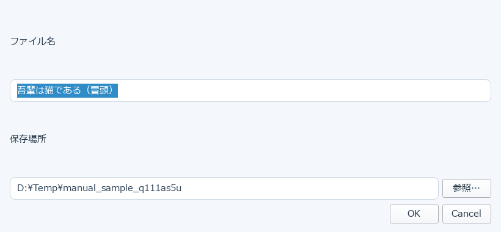
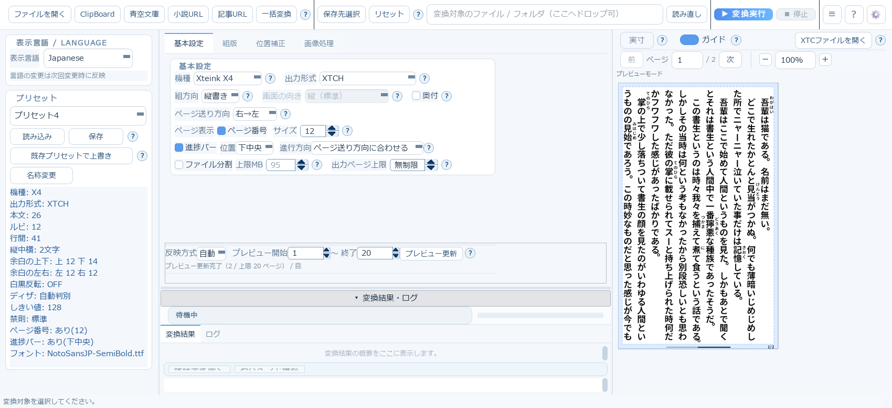
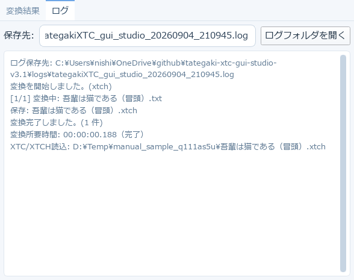

# 5. 変換を実行して結果を確認する

設定が決まったら、画面右上の **［変換実行］** を押します。この章では、押したあと何が起こるかを順に説明します。

## 5-1. 出力設定の確認

変換実行を押すと、まず出力先の確認ダイアログが開きます。

- **ファイル名**: 変換元のファイル名から自動的に候補が入ります。変更できます（拡張子は出力形式に応じて自動で付きます）
- **名前の形式（任意）**: 【v5.0.0eから】書籍情報からファイル名を自動で付けるための形式です（下記）
- **保存場所**: 保存先フォルダです。［参照…］で変更できます

ここで指定した保存場所は、**その回の変換だけ**に使われます。毎回同じ場所に保存したい場合は、
上部ツールバーの［保存先選択］で既定の保存先を決めておくと、ここに最初から入った状態になります
（解除は［リセット］）。

### 名前の形式（出力ファイル名を自動で付ける）

【v5.0.0eから】「名前の形式」の欄に、`{author}` のような**変数**と普通の文字を組み合わせて書くと、
書籍情報からファイル名を作って「ファイル名」の欄へ入れます。欄を書き換えると、すぐ上のファイル名も変わります。

| 変数 | 入るもの |
|---|---|
| `{title}` | 書名 |
| `{author}` | 作者 |
| `{publisher}` | 出版社 |
| `{series}` | シリーズ名 |
| `{filename}` | 変換元のファイル名（拡張子なし） |

例：`[{author}]{title}` と書くと、`[夏目漱石]吾輩は猫である.xtc` のような名前になります。

- 書くのは**拡張子より前の部分だけ**です。拡張子と、LZ4圧縮版の `_comp`／`_comp_v2`、同名を避ける番号は、今までどおりアプリが付けます。
  たとえば `[{author}]{title}` で LZ4圧縮すると `[作者名]書名_comp.xtc` になります（`_comp` を形式に書く必要はありません）
- 値は**書籍情報**から取ります。書籍情報で手入力した値があればそれを、なければファイルから読み取った値を使います（[8章](08-book-metadata.md)）
- 値が無い変数は空になります。周りの文字は消えないので、作者が無いと `[]書名` になります。名前全体が空になるときは、いつもの名前を使います
- 値の中にファイル名に使えない文字（`/` `:` `?` など）があるときは `_` に置き換えます
- 形式に使えない変数名や、ファイル名に使えない文字を書くと、欄の下に理由が出て［OK］を押せません。
  `{` `}` そのものを名前に入れたいときは `{{` `}}` と書きます
- 書いた形式は次の変換でも使われます。前に同じファイルを変換したときの名前より、形式で作った名前を優先します。
  欄を空にすると、いつもの名前に戻ります
- 「ファイル名」の欄を自分で書き換えたときは、その名前で保存します
- 形式が使われるのは、ファイルを1つ変換するときのこの画面だけです。フォルダ一括変換（[12章](12-folder-batch.md)）とバッチ実行（[20章](20-batch-mode.md)）の名前は変わりません

## 5-2. 変換中

変換が始まると、中央の下部に進捗バーと状態表示が出ます（初期状態では「待機中」と出ている欄です）。

- 進捗バーの左のラベルに「変換中」「完了」などの状態が出ます
- 複数ファイルを変換しているときは `[2/5]` のように何件目かが表示されます
- 途中でやめたいときは、右上の **［停止］** を押します

## 5-3. 変換完了

完了すると、右ペインの上に完了通知が出て、変換したファイルが右ペインで自動的に開きます。
通知には保存したファイル名・保存先・次にできることが書かれています。［閉じる］で消せます。

### 変換結果・ログの欄を開く

変換結果とログは、中央の下部にある **［▸ 変換結果・ログ］** の欄にまとまっています。
**初期状態では畳まれている**ので、押して開いてください（もう一度押すと畳みます。開閉の状態は次回も保たれます）。

ログにエラーや失敗が書かれたときは、この欄が自動で開き、「ログ」タブに切り替わります。

## 5-4. 「変換結果」タブ

**変換結果** タブに、その回の結果がまとまります。

- 上部に **保存 / 自動連番 / 上書き** の件数が出ます
  - *自動連番* … 同名ファイルがあったため `foo(1).xtc` のように名前を変えて保存した件数
  - *上書き* … 既存ファイルを上書きした件数

> 保存先に同じ名前のファイルがあるときの動作は、歯車メニューの **同名出力** で選べます
> （**自動連番で保存**（既定）／**同名なら上書き**／**同名ならエラー**）。
> 「エラー」を選ぶと、そのファイルは保存せずエラーとして記録します。
- **［保存先を開く］** … 出力フォルダをエクスプローラー（macOS版では Finder、Linux版ではファイルマネージャー）で開きます
- **［右ペインで確認］** … 一覧で選んだファイルを右ペインのビューワーで開きます
  （一覧のファイルを**ダブルクリック**しても同じです）

複数ファイルを変換したときは、一覧から1つ選んで中身を確かめる、という使い方になります。

## 5-5. 「ログ」タブ

**ログ** タブには、変換の経過が時系列で残ります。

うまくいかないときは、まずここを見てください。どのファイルで止まったか、どんな理由かが分かります。

- **保存先** … ログファイルの実体の場所です。［ログフォルダを開く］で開けます
- 不具合を報告するときは、このログの内容を添えていただけると原因の特定が早くなります

→ 次は、右ペインのプレビューの使い方です。[6. プレビュー（右ペイン）](06-preview.md)
