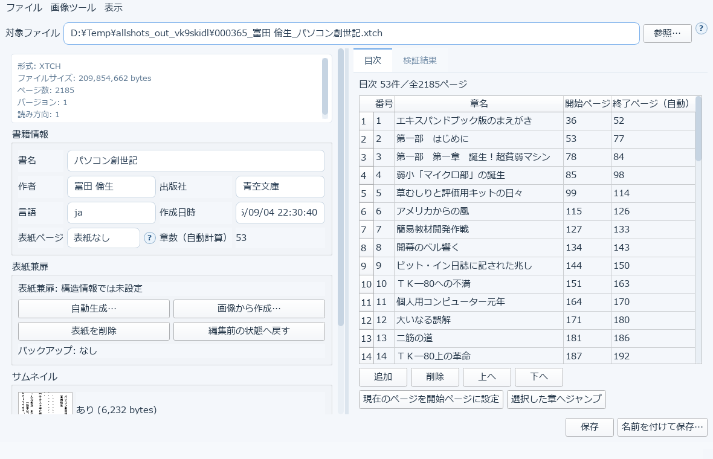
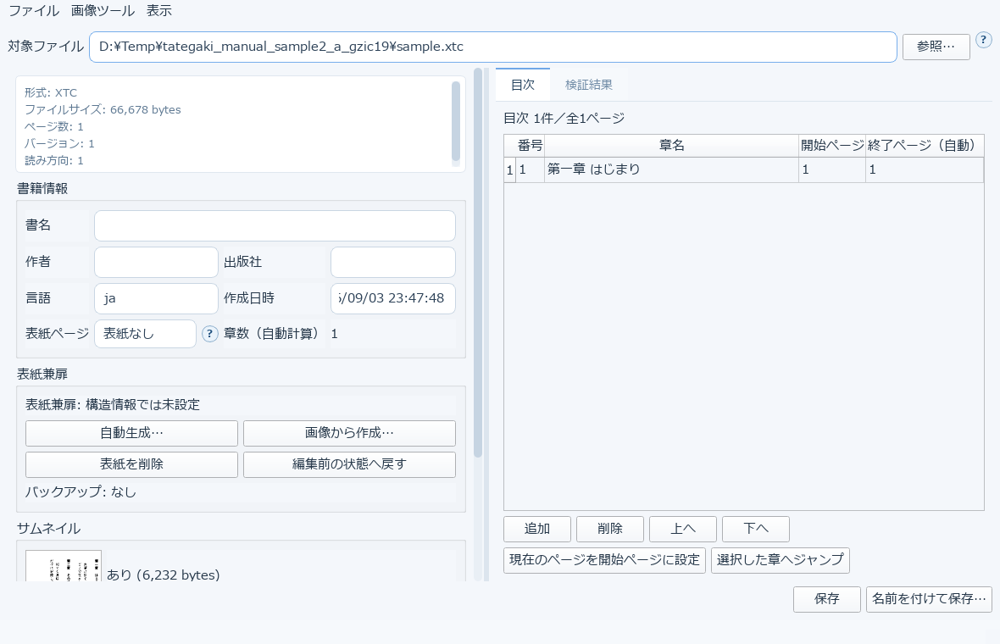
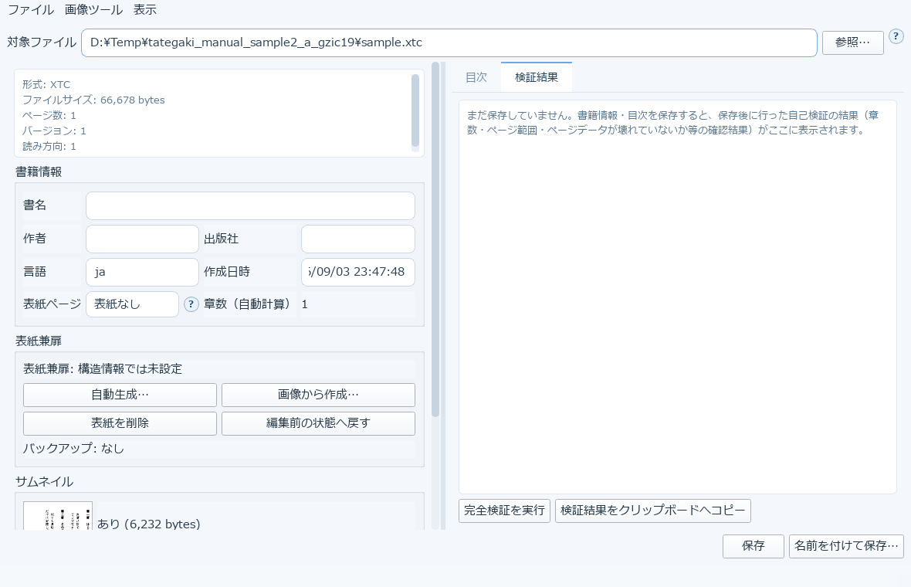
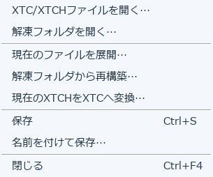
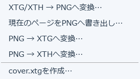

# 14. XTCツール

すでに作成したXTC / XTCH / XTG / XTH ファイルを開いて、**変換し直さずに**中身を編集できるツールです。
メイン画面とは別のウィンドウで開きます。

対象ファイルは、欄へドラッグ＆ドロップするか「参照…」から選びます。

読み込むと、形式・ファイルサイズ・ページ数・バージョン・読み方向といった基本情報と、
書籍情報・表紙兼扉・サムネイルが表示されます。

- **書籍情報** … 書名・作者・出版社・言語・作成日時をその場で編集できます
- **表紙ページ** … 表紙として扱うページを指定します
- **表紙兼扉** … 「自動生成…」「画像から作成…」「表紙を削除」「編集前の状態へ戻す」。
  編集前の状態は自動的にバックアップされます
- **サムネイル** … 埋め込まれているサムネイルを確認できます

## 目次タブ

章の一覧を、番号・章名・開始ページ・終了ページ（自動計算）の表で編集できます。

- **追加・削除・上へ・下へ** … 章の追加や並び替え
- **現在のページを開始ページに設定** … 表示中のページを、選択中の章の開始ページにします
- **選択した章へジャンプ** … 選んだ章の先頭ページへ移動します

## 検証結果タブ

書籍情報・目次を保存すると、保存後に行った自己検証の結果（章数・ページ範囲・ページデータが
壊れていないか等）がここに表示されます。

- **［完全検証を実行］** … いつでも手動で検証できます
- **［検証結果をクリップボードへコピー］** … 結果をそのままコピーできます

---

## LZ4圧縮して保存

ウィンドウ下部の **［LZ4圧縮して保存］** で、開いているXTC/XTCHのページをLZ4で圧縮したファイル（`*_comp`）を、
同じフォルダへ作ります。ページ単位で小さくなる場合だけ作ります。

- 圧縮はディスク上のファイルから作ります。【v5.0.0fから】書籍情報や目次を変えて**まだ保存していない**ときは、
  先に「保存されていない変更があります」と確認が出ます。保存してから圧縮する・変更を捨てて圧縮する・圧縮をやめる、の3つから選びます
  （保存に失敗したときは圧縮しません）
  （v5.0.0e までは確認が出ず、保存していない変更が圧縮版に入りませんでした）
- 圧縮が終わると、XTCツールは圧縮版のファイルに切り替わります

> **LZ4圧縮したファイルは Simple Reader OS（SROS）専用**です。純正ファームウェアやほかのビューアでは開けません（→ [21章](21-sros.md)）。
> Trial版にはこのボタンがありません。INI で `lz4 = false` を指定しているときは押せません（[2章](02-basic-settings.md#lz4圧縮)）。

## LZ4解凍して保存

【v5.0.0dから】ウィンドウ下部の **［LZ4解凍して保存］** で、LZ4圧縮したXTC/XTCH・XTCH v2 を、圧縮していない普通のファイルに戻して保存します。
SROS 以外の端末やビューアで読みたいとき、書籍情報や目次を編集したいとき（圧縮したファイルは読み取り専用です）に使います。

1. 歯車メニューの「XTCツール…」で、圧縮したファイルを開きます
2. **［LZ4解凍して保存］** を押します
3. 同じフォルダに圧縮していないファイルができ、XTCツールとメイン画面のプレビューがそのファイルに切り替わります

| 元のファイル | できるファイル |
|---|---|
| `本_comp.xtc` | `本_decomp.xtc` |
| `本_comp.xtch` | `本_decomp.xtch` |
| `本_comp_v2.xtch`（XTCH v2） | `本_decomp.xtch`（普通のXTCH） |

- 元の圧縮ファイルはそのまま残ります。同じ名前のファイルがあるときは `_decomp_2`、`_decomp_3` のように番号を付け、上書きはしません
- ページ・ページ数・読み方向・読書位置・書籍情報・目次・サムネイルはそのまま引き継ぎます。できたファイルは、普通のXTC/XTCHと同じように編集できます
- 処理はバックグラウンドで、ページを1枚ずつ戻して書き込みます。【v5.0.0fから】大きなファイルでも、ファイル全体を一度にメモリへ読み込みません
- 途中で壊れたページが見つかったときや、処理中に元のファイルが変わったときは、できあがりのファイルを作りません
- 圧縮したページが入っていないファイルでは、ボタンは押せません。XTG/XTH の画像1枚のファイルには使えません
- 解凍するとファイルが大きくなります。保存先に空きが必要です
- 【v5.0.0fから】以前の版で表紙を編集した圧縮ファイル（表紙編集の情報とサムネイルが付いたもの）も解凍できます

> 解凍は Trial版でも使えます（圧縮の［LZ4圧縮して保存］と「LZ4一括圧縮…」は Full版だけです）。

## LZ4一括圧縮（歯車メニュー）

【v4.0.6から】歯車メニューの **「LZ4一括圧縮…」** で、非圧縮のXTC/XTCHをまとめてLZ4圧縮できます。XTCツールで1つずつ開かなくても済みます。

- **ファイルを選ぶ**か、**フォルダーを選ぶ**（サブフォルダーも含めます）と、中の非圧縮のXTC/XTCHを圧縮して `*_comp.xtc`／`*_comp.xtch` を作ります
- Comic の大きさ（960×1600／1056×1584）のXTCHは、XTCH v2（`*_comp_v2.xtch`）にします
- 保存先は、元のファイルと同じフォルダーか、フォルダー構成を保ったまま指定のフォルダーへ置くかを選べます
- 同じ名前の圧縮版があるときは、スキップするか、`_comp_2` のような番号付きで保存します。上書きはしません
- 元のファイルは変更しません。書き込んだファイルは読み直して、全ページを元のページと照合してから保存します

> 圧縮したファイルは **SROS 専用**です（→ [21章](21-sros.md)）。Trial版にはこの項目がありません。

## 上部メニュー

XTCツールの機能の多くは、上部メニューにあります。

### ファイルメニュー

| 項目 | 内容 |
|---|---|
| XTC/XTCHファイルを開く… | 編集対象のファイルを開きます |
| 解凍フォルダを開く… | 展開済みのフォルダを読み込みます |
| 現在のファイルを展開… | 開いているファイルをフォルダへ展開します（ページを1枚ずつ取り出せます） |
| 解凍フォルダから再構築… | 展開したフォルダから、XTC/XTCHを組み直します |
| **現在のXTCHをXTCへ変換…** | 4階調のXTCHを2階調のXTCへ変換します |
| 保存 / 名前を付けて保存… | 上書き保存 / 別名保存 |
| 閉じる | ウィンドウを閉じます |

「展開 → 中の画像を差し替える → 再構築」という流れで、**ページ単位の差し替え**ができます。

### 画像ツールメニュー

| 項目 | 内容 |
|---|---|
| **XTG/XTH → PNGへ変換…** | XTG/XTH形式の画像ファイルを、普通のPNG画像に変換します |
| 現在のページをPNGへ書き出し… | 表示中のページを1枚のPNGとして保存します |
| **PNG → XTGへ変換…** | PNG画像をXTG（2階調）へ変換します |
| **PNG → XTHへ変換…** | PNG画像をXTH（4階調）へ変換します |
| **cover.xtgを作成…** | 外付けの表紙画像 `cover.xtg`（180×270）を作成します |

XTG/XTHはXTC/XTCHの中で使われている画像形式です。このメニューがあることで、

- 端末用の画像を単体で作る
- 中身の画像を取り出して確認する
- 表紙画像だけを差し替える

といった作業が、変換をやり直さずにできます。

> `cover.xtg` は**外付けの**表紙ファイルです。
> XTC/XTCHの内部に埋め込むサムネイルとは別物です（→ [8章](08-book-metadata.md#8-4-サムネイルタブ)）。

### 表示メニュー

- **メイン画面の前面に固定** … XTCツールのウィンドウを常にメイン画面より前に表示します

---

## 保存について

「保存」は元のファイルを上書きします。「名前を付けて保存…」は別ファイルとして保存します。
表紙編集前バックアップの上に保存しようとすると、複製してから編集するか確認されます
（バックアップ自体を上書きすることはできません）。

> 128MiB以上のファイルの書籍情報・目次保存はバックグラウンドで実行されます。
> 処理中は編集操作と終了が一時的に無効になります。
> **安全保存の途中でOSからプロセスを強制終了しないでください。**

## 読み取り専用で開くファイル

次のファイルは中身の確認はできますが、編集・保存はできません。
基本情報の欄に「編集: 読み取り専用（…）」と理由が表示され、
「保存」「名前を付けて保存」「表紙操作」「XTCH→XTC変換」が無効になります。

- **LZ4圧縮ページを含むファイル** … Studio の LZ4圧縮や、Simple Reader OS（SROS）向けのツールで圧縮したXTC/XTCH。
  編集したいときは、[LZ4解凍して保存](#lz4解凍して保存)で普通のファイルに戻します
- **16GiBの編集上限を超えるファイル**

→ [15. 大きなEPUBを巻分割する](15-epub-split.md)
